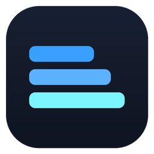
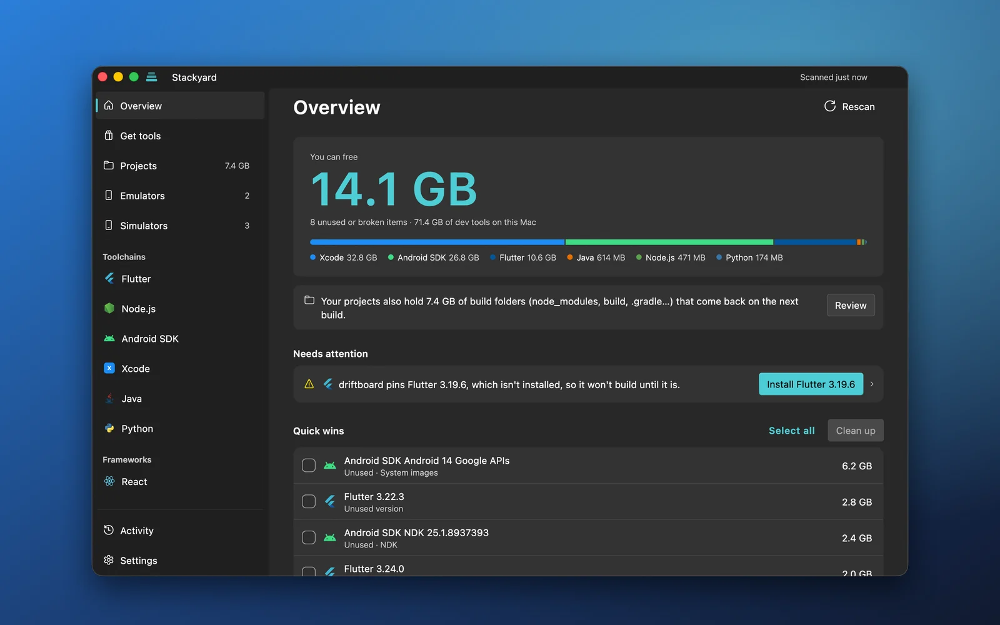
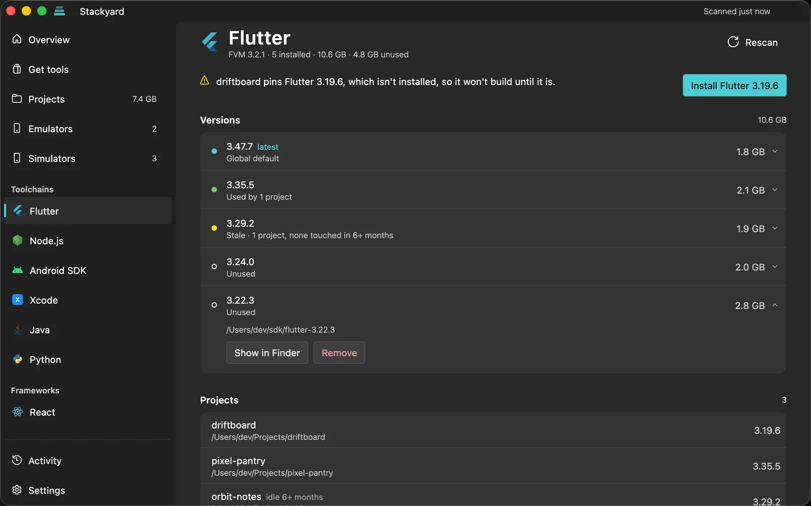
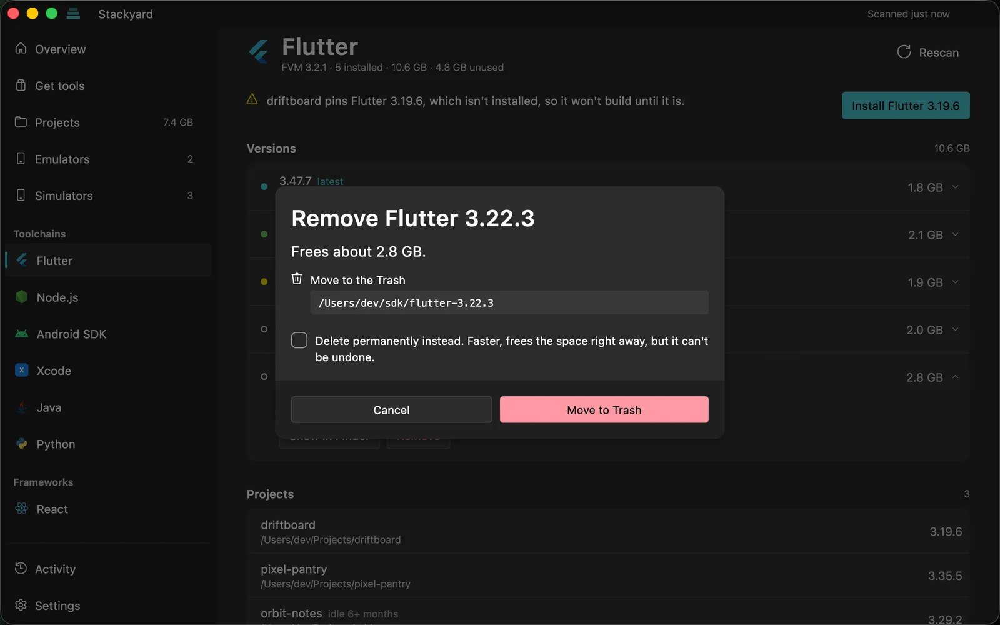
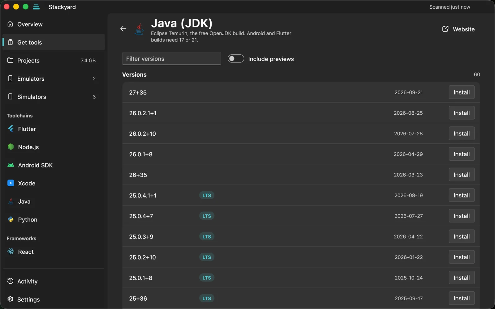
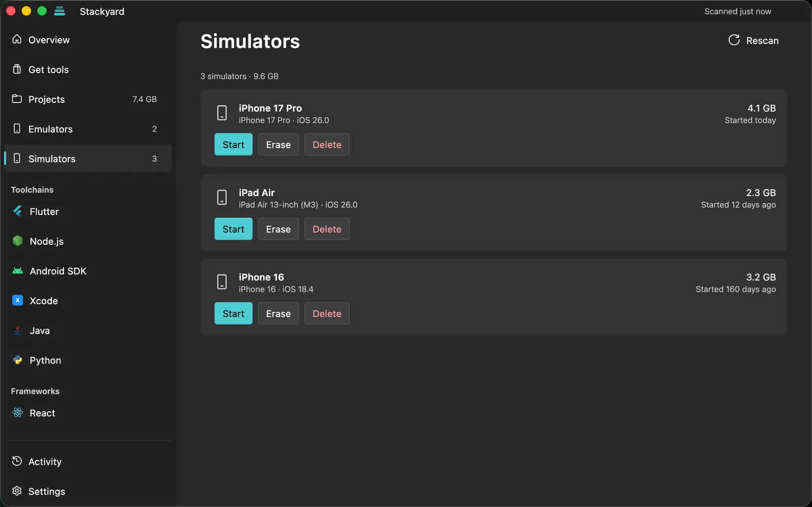

<p align="center">
  
</p>

<h1 align="center">Stackyard</h1>

<p align="center">
  <b>See every SDK and toolchain on your machine, which projects use each version, and what's safe to remove.</b><br>
  Free and open source, for Windows and macOS.
</p>

<p align="center">
  <a href="https://github.com/AqibJavedZeepalm/stackyard/releases/latest"></a>
  <a href="https://github.com/AqibJavedZeepalm/stackyard/releases/latest"></a>
</p>

<p align="center">
  <a href="https://github.com/AqibJavedZeepalm/stackyard/releases/latest"></a>
  <a href="https://github.com/AqibJavedZeepalm/stackyard/actions/workflows/ci.yml"></a>
  <a href="LICENSE"></a>
  <a href="#download"></a>
  <a href="https://aqibjaved.dev/coffee"></a>
</p>

<p align="center">
  
</p>

<p align="center">
  <b>Works with</b> Flutter (FVM) · Node.js (nvm, fnm, Volta) · Android SDK and emulators · Xcode simulators and runtimes · Gradle · Java · Python · .NET<br>
  and spots React, React Native, Expo, Next.js, Vue, Angular, Svelte and more in your projects.
</p>

## Why

Version managers like FVM, nvm, pyenv and SDKMAN are great at installing versions. None of them tells you that you have six Flutter SDKs, three Android NDKs and a 13 GB emulator you haven't started in a year. Stackyard does.

It shows every SDK, toolchain and framework version on your computer, which projects use each one, and what's safe to remove. Then it fixes what's wrong with one click, and nothing is deleted without you seeing it first.

## Features

- **Set up in a minute.** On first launch Stackyard finds the folders where your projects live, shows how many projects each holds, and lets you add more.
- **One window for every tech.** A sidebar entry appears only for techs found on your machine.
- **Get tools.** A marketplace of SDKs and CLIs (Flutter, Android command-line tools, Node.js, Python, Java, .NET, Go, Rust, Deno, Bun, Gradle, and the Angular, Expo, NestJS, Firebase, Vercel, Ionic, Nx, TypeScript, pnpm and Yarn CLIs). Every version is listed from the publisher's own release feed. Downloads come straight from the publisher and are checked against their published hash. Before installing, you choose the folder and which environment variables to set (`PATH`, `JAVA_HOME`, `GOROOT`…): your user variables or everyone's on Windows, a marked block in `~/.zprofile` on macOS. Installed versions can be made the default or removed later, which cleans up their variables too.
- **Knows who uses what.** It reads `.fvmrc`, `.nvmrc`, `package.json`, `gradle-wrapper.properties`, `build.gradle`, `local.properties`, `.python-version`, `global.json` and more across your project folders.
- **Problems come with a fix button.** Missing versions a project needs, two setups fighting over a folder, a broken `JAVA_HOME`: each is explained in plain words, with a button that fixes it. You never type a command.
- **Environment doctor.** Finds `JAVA_HOME` / `ANDROID_HOME` pointing at folders that are gone, dead and duplicate PATH entries (it saves a backup first), and a Java that's too new or too old for a Flutter app's Gradle and Android Gradle Plugin.
- **Project cleanup.** Shows the `node_modules`, `build`, `.dart_tool`, `.gradle`, `Pods` and other rebuildable folders in your projects, with a one-click clean for projects you haven't touched in months.
- **Emulator manager.** Start, cold boot, wipe data, delete snapshots or delete each Android emulator, with its size and when it last ran.
- **Simulators (macOS).** Every iOS, watchOS, tvOS and visionOS simulator with its size and last start: start, shut down, erase or delete it. The Xcode page shows each simulator runtime (often 8 GB each), which simulators use it, and Xcode's rebuildable caches.
- **Progress you can see.** Every install, removal and fix runs in Activity with its live output and a real progress bar. Cancel stops it cleanly, without leaving half a download behind.
- **Safe removal.** Things go to the Recycle Bin / Trash by default, or you can choose to delete permanently. Installed programs are removed with their own uninstaller. Links are removed as links; what they point to is never touched. You see every step before it runs, and a spinner wherever work is happening.
- **Runs in the background.** Closing the window keeps Stackyard in the system tray (Windows) or menu bar (macOS). It checks your setup daily or weekly and notifies you only when there's something new. It can start at sign-in.
- **Move your setup.** Export your toolchain versions to a file and import it on another computer to install what's missing.
- **Never edits your projects.** It doesn't change a project's pinned versions, because that can break builds.
- **Native feel.** Windows 11 Fluent design with Mica and your accent color; on macOS, the glass sidebar and motion of a Mac app. A Glass slider sets how much of your desktop shows through.

## Screenshots

<p align="center">
  
</p>

<table>
  <tr>
    <td width="50%"><br><sub>Every version, its size and the projects that use it</sub></td>
    <td width="50%"><br><sub>You see exactly what happens before anything runs</sub></td>
  </tr>
  <tr>
    <td width="50%"><br><sub>Install SDKs and CLIs straight from the publisher</sub></td>
    <td width="50%"><br><sub>Simulators and emulators with their size and last start</sub></td>
  </tr>
</table>

Screenshots are from macOS with demo data; the animation at the top is from the Stackyard film. On Windows the same pages use Windows 11's Fluent design and Mica.

## What it detects

| Tech | Where it looks | How it knows a project uses it |
|---|---|---|
| Flutter | FVM (`fvm api list`), standalone SDK on PATH | `.fvmrc`, `.fvm/fvm_config.json`; unpinned projects use the global version |
| Node.js | nvm (nvm-windows on Windows), fnm, Volta, Node.js installer, Homebrew | `.nvmrc`, `.node-version`, `package.json` `volta` / `engines` |
| Android SDK | Platforms, build tools, NDKs, system images, emulators, duplicate SDK folders | `compileSdk`, `ndkVersion` (including Flutter's defaults per SDK version), `local.properties` `sdk.dir`, emulator `config.ini` |
| Xcode (macOS) | Simulators and runtimes (`xcrun simctl`), DerivedData, device support files | Which simulators use each runtime |
| Gradle | `~/.gradle/wrapper/dists`, caches | `gradle-wrapper.properties` |
| Java | Program Files vendors, `/Library/Java/JavaVirtualMachines`, Homebrew, `~/.jdks`, SDKMAN, Android Studio JBR | `.java-version` |
| Python | `py` launcher, pyenv / pyenv-win, uv, python.org, Homebrew and Microsoft Store installs | `.python-version`, `requires-python` |
| .NET SDK | `dotnet --list-sdks` | `global.json` `version`, `rollForward` and `allowPrerelease`, resolved the way `dotnet` picks an SDK; no `global.json` uses the newest |
| React, React Native, Expo, Next.js, Vue, Nuxt, Angular, Svelte, Astro, Electron, Vite, TypeScript | Each project's `node_modules` | `package.json` |

Installs use each tech's own manager (FVM, nvm / fnm / Volta, `sdkmanager`). Tools without one are installed with `winget` on Windows and Homebrew on macOS.

## Download

Get the latest version from [Releases](https://github.com/AqibJavedZeepalm/stackyard/releases):

- **Windows 10 / 11:** `Stackyard-Setup-<version>.exe`. It installs for your user only, with no administrator prompt. The installer isn't code-signed yet, so SmartScreen may warn the first time: choose **More info → Run anyway**.
- **macOS 12 or later:** `Stackyard-<version>.dmg`. Open it and drag Stackyard to Applications.

How releases are built and signed: [docs/RELEASING.md](docs/RELEASING.md).

## Run it

Needs Flutter 3.47 or later. The project pins its Flutter version in `.fvmrc`, so [FVM](https://fvm.app) is the easiest way to get the right one.

- **Windows:** Visual Studio 2022 with the "Desktop development with C++" workload.
- **macOS:** Xcode (open it once to accept the license), plus CocoaPods if Flutter asks for it (`brew install cocoapods`). The app runs outside the App Sandbox (see `macos/Runner/*.entitlements`), like other developer tools: it reads SDK folders across your home folder and runs tools such as `fvm`, `brew` and `sdkmanager`.

### macOS

```bash
brew tap leoafarias/fvm && brew install fvm
git clone https://github.com/AqibJavedZeepalm/stackyard.git
cd stackyard
fvm install
fvm flutter config --enable-macos-desktop
fvm flutter run -d macos
```

### Windows

```bash
dart pub global activate fvm   # or: choco install fvm
git clone https://github.com/AqibJavedZeepalm/stackyard.git
cd stackyard
fvm install
fvm flutter run -d windows
```

If the project sits in a very long path on Windows, MSBuild fails with `FTK1011`. `tool/dev.ps1` mirrors the project to a short path and runs Flutter there:

```bash
powershell -File tool/dev.ps1 run -d windows
```

Install a release build for the current user (Start menu entry, desktop shortcut, uninstall from Settings → Apps):

```bash
powershell -File tool/dev.ps1 build windows --release
powershell -ExecutionPolicy Bypass -File tool/install.ps1
```

### Tests

CI runs analyze, the tests and a debug build on macOS and Windows for every push and pull request. The rest touch your real machine, so they run locally only:

```bash
fvm flutter test
fvm flutter test test/scan_smoke_test.dart --dart-define=SMOKE=true          # scans your real machine
fvm flutter test test/market_live_test.dart --dart-define=LIVE=true          # installs every tool into a temp folder, runs it, deletes it
fvm flutter test test/simulators_live_test.dart --dart-define=LIVE=true      # macOS: a throwaway simulator
fvm flutter test integration_test/real_machine_test.dart -d macos            # the real app: every page (-d windows on Windows)
```

`integration_test/actions_test.dart` installs and removes real Flutter and Node versions through the UI; pick versions you don't have with `--dart-define=FLUTTER_TEST_VERSION=… --dart-define=NODE_TEST_VERSION=…`. On macOS, keep the test window in front: macOS stops drawing hidden windows and the test waits.

## Adding a tech

Each tech is one class in `lib/core/techs/` that extends `TechAdapter`:

1. `detect()` finds installed versions and returns a `TechSnapshot`, or `null` if the tech isn't on the machine (then no sidebar entry appears).
2. In `detect()`, link each `InstalledItem` to the projects that use it with `item.usedBy.add(project.toUsage())`. Report problems with `snap.problem(text, [NoteFix(...)])` so each one comes with its fix.
3. Optionally implement `planInstall`, `planSetGlobal`, `planRemove`, `planInstallFromStack` and `availableVersions`. Actions return a `PlannedChange` (commands, file edits, Recycle Bin moves) that the user reviews before anything runs.
4. Register it in `lib/core/registry.dart`.

If a tech only lives inside projects, like a JS framework, add a `FrameworkTech` line to the registry.

## Layout

```
lib/
  core/            scanning and tech knowledge (no UI)
    techs/         one adapter per tech
    doctor.dart    environment checks and their fixes
    project_junk.dart, stack_file.dart, installers.dart, installed_apps.dart, autostart.dart
  state/           app state, settings, job queue, background (tray, checks), notifications
  ui/              Fluent UI: shell, pages, dialogs, onboarding, motion, report a problem
```

## Code signing policy

Windows releases aren't code-signed yet. Stackyard has applied for free open-source signing from [SignPath Foundation](https://signpath.org); once approved, Windows releases will be signed through [SignPath.io](https://signpath.io) under this policy. macOS releases are signed with the maintainer's Apple Developer ID and notarized by Apple.

- Committers and reviewers: [members of this repository](https://github.com/AqibJavedZeepalm/stackyard/graphs/contributors)
- Approvers: the repository owner, [Aqib Javed](https://github.com/AqibJavedZeepalm)

The Windows installer is built from this repository's source by GitHub Actions ([release.yml](.github/workflows/release.yml)), which will also sign it once signing is approved. The macOS DMG is built from the same tagged commit with [tool/release-mac.sh](tool/release-mac.sh), signed, and notarized by Apple, so macOS checks it before it opens.

## Privacy

Everything runs locally. Stackyard only goes online to check for new versions (Flutter releases, nodejs.org, the npm registry…) and to download the tools you choose to install. No accounts, no telemetry. "Report a problem" opens a GitHub issue in your browser with your app and OS versions filled in; nothing is sent until you submit it there.

## Contributing

Bug reports, fixes and support for new techs are all welcome. Read [CONTRIBUTING.md](CONTRIBUTING.md) first: it has the rules that keep Stackyard safe to run on people's machines, how to set up the project, and what a pull request needs.

## Support

Stackyard is free and stays free. If it saved you some disk space or an afternoon of fighting `JAVA_HOME`, you can [buy me a coffee](https://aqibjaved.dev/coffee). It keeps the project going, and it's never required for anything: every feature is in the free app.

[](https://aqibjaved.dev/coffee)

## License

[MIT](LICENSE). Made by [Aqib Javed](https://aqibjaved.dev).
